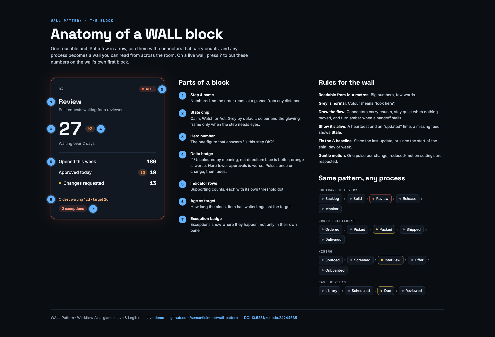

# WALL Pattern

*Workflow At-a-glance, Live & Legible*

**A process wall you can read from across the room.**
One HTML file, one config, one feed. Any process becomes a live wall of connected steps: what is calm, what needs eyes, and what changed since you last looked.

`PATTERN · FORMAT · RENDERER` · MIT · 2026 · [Semantic Intent](https://semanticintent.dev) · [DOI 10.5281/zenodo.24244635](https://doi.org/10.5281/zenodo.24244635)


*Two feed snapshots, five minutes apart. The source reported only what was true each time; the wall worked out the rest. Inventory rose by 8 and crossed into **Act**, the handoff into it stalled (**SHORT**), and "What changed" lists exactly that. Everything else stayed grey.*

---

## Why

Most dashboards answer *"how are we doing?"* with KPI tiles and charts. People who run a process ask something else: *"where is work stuck, and what changed?"*

WALL Pattern answers that second question, as an open pattern:

- **Show the flow, not just the numbers.** Steps are joined by connectors that carry counts.
- **Grey is normal.** Colour appears only when a step needs attention.
- **Show change, not just state.** Every update pulses what moved and shows ↑↓ deltas, coloured by meaning.
- **Arranged once, then fixed.** You can arrange the layout like a diagram, then pin it so the wall stays stable.

## Quick start

**Live demo:** [semanticintent.github.io/wall-pattern](https://semanticintent.github.io/wall-pattern/) · [as a wall screen](https://semanticintent.github.io/wall-pattern/?kiosk=1) (press **K** for controls)

Or locally:

```
open index.html
```

That's it. The wall opens on the **Fernhill Provisions** example, a fictional food wholesaler, with simulated data:
Orders → Inventory → Fulfilment → Shipping → Invoicing, with backordered lines looping back to Orders.

### Try your own, in the browser

1. Open the [live demo](https://semanticintent.github.io/wall-pattern/).
2. Drag your `wall.config.json` and `wall.feed.json` onto the page, together or one at a time.
3. Drop a second feed snapshot to see what changed between the two.

Nothing is uploaded: the files are read in your browser and never leave it. To try it without writing anything, download the files from [`examples/hiring-pipeline/`](examples/hiring-pipeline/) and drop them in. **Source & settings** offers the same as file pickers, plus watching a feed file that a system rewrites on a schedule.

### Build one with an agent

[`skills/wall-pattern/SKILL.md`](skills/wall-pattern/SKILL.md) is a skill for Claude (or any agent that reads skills). It interviews you about the process, writes the config, writes a feed exporter in your own stack, and tests the result with two snapshots. It carries what the schemas can't: one hero number per step, thresholds that keep an ordinary day grey, and flows that need memory so the first run doesn't report the whole backlog as new. In Claude Code, copy the folder into your project's `.claude/skills/`; on claude.ai, upload it as a skill.

### Build one with any chat assistant

Using Microsoft Copilot, ChatGPT, Gemini or another chat assistant? Give it [`docs/for-assistants.md`](docs/for-assistants.md): paste it in or attach it, then describe your process or share a sample of your data. It is one self-contained file with the format, the rules, a spreadsheet-to-feed converter and a worked example ([`examples/repair-desk/`](examples/repair-desk/)), so the assistant can draft the config, write the spreadsheet formulas and help you schedule the update. In an organisation it can be added as a knowledge file to a custom assistant.

## The two files

WALL Pattern separates **structure** from **numbers**.

| File | Changes | Describes |
|---|---|---|
| `wall.config.json` | rarely | steps, indicators, thresholds, connectors, loops, exceptions, display |
| `wall.feed.json` | every update | current values, flows, ages of oldest items, open exceptions |

The feed carries **no deltas**. The wall computes them by comparing each snapshot with the previous one, or with the start of the current window: a shift, a day or a week (`display.delta.window`). A source system only has to report what is true *now*.

Schemas: [`schema/wall.config.schema.json`](schema/wall.config.schema.json) · [`schema/wall.feed.schema.json`](schema/wall.feed.schema.json) (JSON Schema 2020-12)

### Minimal config

```json
{
  "schemaVersion": "1.0",
  "id": "orders",
  "title": "Order Fulfilment",
  "steps": [
    { "id": "picked", "name": "Picked", "hero": { "id": "picked_n", "label": "Waiting to pack" } },
    { "id": "packed", "name": "Packed", "hero": { "id": "packed_n", "label": "Waiting to ship",
      "goodDirection": "down", "thresholds": { "watch": 40, "act": 80 } } }
  ],
  "connectors": [ { "id": "c1", "from": "picked", "to": "packed", "caption": "packed" } ]
}
```

### Minimal feed

```json
{
  "schemaVersion": "1.0",
  "wallId": "orders",
  "generatedAt": "2026-11-14T13:53:56-05:00",
  "values": { "picked_n": 112, "packed_n": 46 },
  "flows": { "c1": { "sinceLastUpdate": 3, "sinceShiftStart": 58 } }
}
```

## Anatomy of a block

[](https://semanticintent.github.io/wall-pattern/anatomy.html)

Each step is the same reusable unit ([as a page](https://semanticintent.github.io/wall-pattern/anatomy.html)). On a live wall, press **?** or **How to read** to put these numbers on the wall's own first block:

1. **Step & name**, numbered, so the order reads at a glance.
2. **State chip**: Calm, Watch or Act. Colour and a glowing frame appear only above Calm.
3. **Hero number**: the one figure that answers "is this step OK?"
4. **Delta badge**: ↑/↓ coloured by *meaning* (`goodDirection`), not by direction. Blue is better, orange is worse. It pulses once, then fades.
5. **Indicator rows**: supporting counts, each with its own threshold dot.
6. **Age vs target**: how long the oldest item has waited.
7. **Exception badge**: exceptions show where they happen, not only in their own panel.

## Rules for the wall

- Readable from four metres: big numbers, few words.
- Grey is normal; colour means "look here".
- Draw the flow: connectors carry counts and turn amber when a handoff stalls (`stallWhen`). A connector where nothing moved stays quiet: only its total, muted, or only its caption.
- Show it's alive: a heartbeat and an "updated" time. A missing feed shows **Stale** (`staleAfterMinutes`).
- Fix the Δ baseline: since the last update, or since the start of the shift, day or week (`delta.window`, with `shiftStart` or `weekStart`).
- Gentle motion: one pulse per change, and reduced-motion settings are respected.

## Layouts

| Layout | What it is |
|---|---|
| **Row** | Steps in a line. Return loops sweep underneath. Exceptions and "What changed" panels sit below. |
| **Orbit** | Steps on a ring with **Exceptions as the hub**. Spokes show exceptions per step (thicker means more), and dots flow along curved connectors, faster with more volume. Drag to arrange, then **Pin**. The layout is saved per wall in the browser. |

## Wall-screen links

```
index.html?config=CONFIG_URL&feed=FEED_URL&layout=orbit&pin=1&kiosk=1
```

| Param | Effect |
|---|---|
| `config` | load a config from a URL (falls back to the built-in example) |
| `feed` | poll a feed URL: every 10 s in Live mode, or on the chosen interval |
| `layout` | `row` or `orbit` |
| `pin=1` | lock block positions |
| `kiosk=1` | hide the controls (press **K** to toggle) |

Keys: **?** explains the wall (numbers on the first block, plus a short guide) · **K** shows or hides the controls · **F** toggles full screen · **Esc** closes settings and the guide.

## Feeding it from a business system

The renderer only reads JSON, so the integration can be as light as a scheduled export.

| Setup | How | Notes |
|---|---|---|
| **Same server** | Serve `index.html` next to `wall-feed.json` | Simplest for a wall screen. No cross-site issues. |
| **Shared folder** | The system writes `wall-feed.json` on a schedule; a static web server shares the folder | No API work at all. Good fit for older systems. |
| **Feed API** | Point `?feed=` at an endpoint returning the feed JSON | If the HTML is hosted elsewhere, or opened from a local drive, the endpoint must send a CORS header (`Access-Control-Allow-Origin`). |
| **Watch a local file** | **Source & settings → Pick a feed file to watch**. The business system overwrites `wall-feed.json` on a schedule (for example in a shared folder) | No server, no CORS. The wall re-reads the file on every refresh (Live = every 5 s) and only updates when it changed. Nothing is uploaded. Remembered across reloads: click **Resume watching**. Chrome and Edge only (File System Access API). |
| **Files by hand** | Drop snapshots onto the page | Any browser. Drop two in a row to see what changed. |

**Data and security**
- Expose summary numbers and short exception texts only. Anyone who can open the feed can read all of it.
- Never put credentials or API keys in the HTML. Protect the feed on the server side, for example by making it reachable only on the internal network.
- The page sends nothing anywhere. It only fetches the feed and config you point it at. Fonts load from Google Fonts and fall back to system fonts when offline.

## Repository layout

```
index.html                       the renderer: self-contained, no build step
anatomy.html                     the anatomy of a block, as a page
CHANGELOG.md                     what changed in each version
docs/for-assistants.md           one-file guide for any chat assistant (Copilot, ChatGPT, …)
docs/adapters.md                 design note: adapters, spreadsheets, setup agent (proposed)
docs/sharing-and-offline.md      design note: reaching a feed, capability URLs, CORS, offline walls (proposed)
skills/wall-pattern/SKILL.md     a skill: build a wall for your own process
schema/
  wall.config.schema.json        structure of a wall
  wall.feed.schema.json          one live snapshot
examples/
  fernhill-provisions/           order to cash: five steps, backorder loop, exceptions hub
  hiring-pipeline/               four steps, light theme, return loop
  repair-desk/                   fed from a spreadsheet tab: CSV + a stdlib Python converter
glyph/
  wall-pattern.svg               the mark (currentColor), for pages
  wall-pattern-amber.svg         the same mark in amber, for this README
README.md
LICENSE
```

## Status

v0.1 is a working renderer and a schema-validated contract. Honest gaps:

| Item | State |
|---|---|
| Row and Orbit layouts, deltas, stall rules, exceptions, change log, kiosk, URL params | working |
| `display.layout: "free"` | rendered as Orbit, using each step's `position` |
| `exceptions.placement: "satellites"` | in the schema; renders as hub (Orbit) or panel (Row) |
| `step.drillUrl` | in the schema; not wired to clicks yet |
| Custom `states` beyond three | labels and colours work; thresholds only define `watch` and `act` |
| Watch a local feed file (re-read on each refresh, no server) | working in Chrome and Edge; other browsers fall back to drop-in files |
| Delta window: `shift`, `day` or `week` (v0.2) | working; without a feed baseline, the wall resets its own on the first snapshot of each new window |
| Adapters: map an existing endpoint to a feed, in the browser or at the edge | proposed, not implemented; see [docs/adapters.md](docs/adapters.md) |
| Spreadsheet input via a converter (a `wall` tab saved as CSV → feed) | working; see [examples/repair-desk/](examples/repair-desk/) and [docs/for-assistants.md](docs/for-assistants.md) |
| CSV read directly by the renderer, and a setup agent for people without a coding workflow | proposed, not implemented; see [docs/adapters.md](docs/adapters.md#spreadsheets-without-writing-code) |
| Offline wall (renderer, config and snapshots in one HTML file), capability-URL guidance | proposed, not implemented; see [docs/sharing-and-offline.md](docs/sharing-and-offline.md) |
| Schema validation in the page | basic checks, plus id and colour patterns enforced before anything reaches the page; the schemas are the source of truth |

All company, customer, product and carrier names in the examples are fictional.

## The mark

Two courses of brick in a running bond, one brick lit. It is a wall, it is grey, and one place needs eyes. Drawn to the semanticintent.ai glyph rules: 24-unit grid, 1.75 stroke, round caps and joins, lines only plus one solid dot, `currentColor`, reads at 16 px. The renderer uses it as its tab icon.

## Origin

WALL Pattern comes from the same shape as [.netTiers](https://github.com/netTiers/netTiers), the schema-driven code generation framework for .NET (founding contributor, 2005–2010): structured input goes in, generated output comes out, a full admin UI is rendered from the declared structure rather than built by hand one screen at a time, and a cache layer holds the last known state in between.

The wall is that shape pointed at a screen on the wall:

| .netTiers | WALL Pattern |
|---|---|
| Declared structure the admin UI renders from | `wall.config.json` |
| Structured output from the business tier | `wall.feed.json` |
| Cache layer holding the last known state | the renderer's previous snapshot and window baseline, which is where the deltas come from |
| Rendered UI | `index.html` |

Rebuilt in 2026 as an open pattern, format and renderer, with Claude.

## Licence

MIT © 2026 [Michael Shatny](https://semanticintent.dev) · [Semantic Intent](https://github.com/semanticintent)
